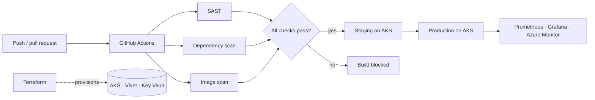

**I deploy, secure and run production workloads on Microsoft Azure, from Kubernetes clusters to company-wide identity.**
Software Engineer II @ xLoop Digital Services, Karachi · Microsoft Certified: Azure Solutions Architect Expert · Azure Administrator Associate
Open to DevOps / Azure Cloud Engineer roles in Karachi 🇵🇰 and remote

---

## ⚡ At a glance

| | |
|---|---|
| ☁️ **Cloud** | Microsoft Azure: AKS, VMs, Static Web Apps, Blob Storage, Key Vault, Azure Monitor, Entra ID |
| 🚢 **Platform** | 10-microservice platform deployed on AKS with Helm, provisioned with Terraform |
| 🔁 **Delivery** | GitHub Actions pipelines with security scans and staging-to-production promotion |
| 🔐 **Security** | 70+ company devices secured with Entra ID, Intune, Conditional Access and Defender, mapped to ISO 27001 |
| 💰 **Cost** | ~$5,500 saved on Azure AI costs by moving to a 3-year Azure reservation |
| 🎓 **Certified** | AZ-305 Azure Solutions Architect Expert · AZ-104 Azure Administrator Associate |

---

## 🏗️ Selected work at xLoop

> The code for these projects belongs to my employer and is private. Happy to walk through the architecture and decisions in an interview.

### 🚢 QAITI: multi-tenant education platform on Azure Kubernetes Service

**My role:** DevOps engineer in a 3-person team, owning deployment and operations end to end.

| Layer | What I built and run |
|---|---|
| **Orchestration** | 10 microservices serving 7 user roles on **AKS**, each packaged as a **Helm** chart |
| **Infrastructure as Code** | **Terraform** for the AKS cluster, virtual networking and Key Vault; every change peer-reviewed before apply |
| **CI/CD** | **GitHub Actions**: static analysis, dependency scan and container-image scan run in parallel; only passing images are promoted from staging to production |
| **Secrets & access** | **Azure Key Vault** with managed identities and RBAC |
| **Observability** | **Prometheus + Grafana** for cluster and service metrics, **Azure Monitor** for Azure resources |
| **Reliability** | Backup and disaster-recovery procedures for platform data |

### 💰 Azure cost optimisation

- Owned the budget for Azure-hosted AI models, compared on-demand and reserved pricing, and designed the supporting architecture.
- Moved the company to a **3-year Azure reservation**, saving **~$5,500**.

### 🔐 Microsoft 365, identity and endpoint security

- Enrolled **70+ Windows and Ubuntu laptops and phones** in **Intune**.
- Configured **Entra ID Conditional Access**, **BitLocker** with remote wipe, USB storage blocking, web filtering, **SSPR** and **Microsoft Defender**, mapped to **ISO 27001** controls.
- Wrote an **8-page Microsoft 365 and Entra ID licensing analysis** and briefed the CEO on the options.
- Designed a **Microsoft Purview eDiscovery** export of Exchange, Teams, SharePoint and OneDrive data, staged through Azure Blob Storage.

### 🎥 xVision: real-time AI monitoring for bank branches and ATMs

- **Release automation:** GitHub Actions pipeline deploying to **Azure Static Web Apps** on every push, with a preview environment for every pull request.
- **Containers:** multi-stage **Docker** build of the frontend, deployed on an **Azure VM**.
- **Frontend:** two linked Next.js/TypeScript dashboards covering 12 monitoring use cases, with live security alerts over 14 WebSocket streams and nonce-based CSP hardening.

### 🧠 GenAI readiness assessment platform (backend)

- **NestJS + PostgreSQL** backend with ~70 REST endpoints.
- **RAG pipeline** grounded in ISO/IEC 42001: OpenAI embeddings, Pinecone vector search, and automatic failover between LLM providers (OpenAI → Groq) so reports keep generating during outages.

---

## 🛠️ Tech stack

**Cloud & Infrastructure as Code**

-E95420?style=for-the-badge&logo=ubuntu&logoColor=white)

**Containers & Orchestration**

-326CE5?style=for-the-badge&logo=kubernetes&logoColor=white)

**CI/CD & DevSecOps**

**Monitoring & Reliability**

**Identity & Security**

**Languages & Frameworks**

---

## 📊 GitHub stats

---

## 🏆 Certifications

[-0078D4?style=for-the-badge&logo=microsoft&logoColor=white)](https://learn.microsoft.com/en-us/users/mehr-110/credentials/fe5cf63e3b327909)
[-0078D4?style=for-the-badge&logo=microsoft&logoColor=white)](https://learn.microsoft.com/en-us/users/mehr-110/credentials/18cb17c0f9395e41)
[-232F3E?style=for-the-badge&logo=amazonwebservices&logoColor=FF9900)](https://www.credly.com/badges/11d98e44-f3b0-472f-bc4e-0069bc806164/public_url)
[-1F4E79?style=for-the-badge&logo=googlecloud&logoColor=white)](https://drive.google.com/file/d/1R1vwQjtK2aJa6dMwrK2dsPRYFSGvTlvU/view)

---

## 🎓 Background

- 💼 **Software Engineer II** at xLoop Digital Services (Jul 2024 – present): DevOps and cloud infrastructure
- 💻 **Software Engineer** at xLoop Digital Services (Feb 2023 – Jun 2024): full-stack and AI development
- 🏛️ **BS Computer Science**, Virtual University of Pakistan (2023 – 2027, in progress) | CGPA 3.4 / 4.0
- 🥇 **Intermediate**: 95%, **8th position** in the Board of Intermediate Education Karachi

---

*Infrastructure you can rebuild from code is infrastructure you can trust.*

